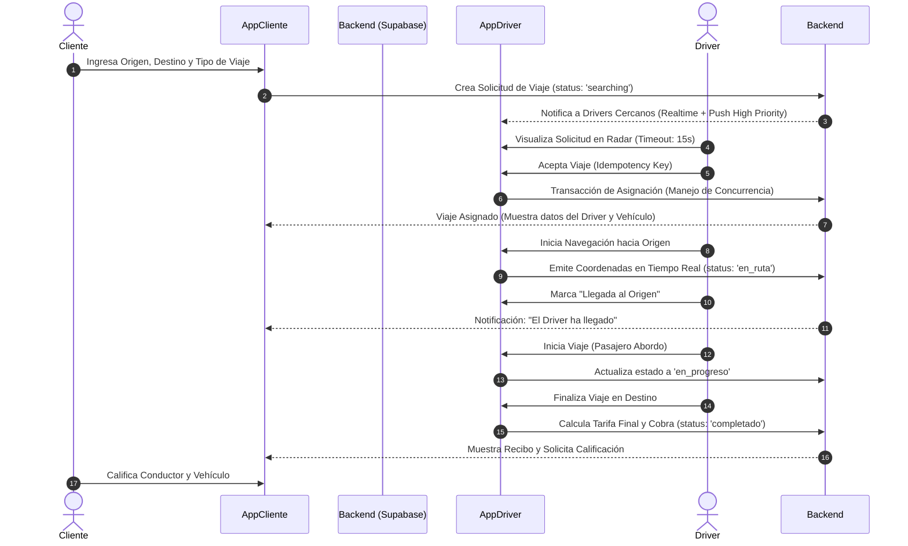
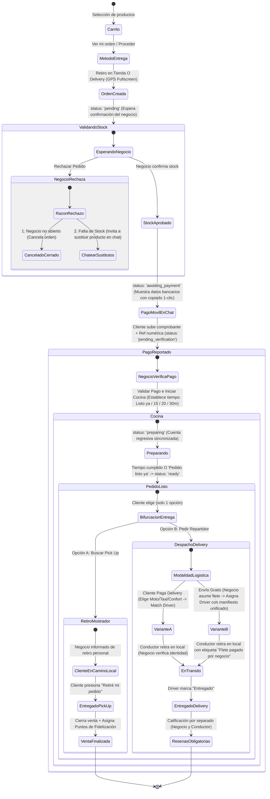
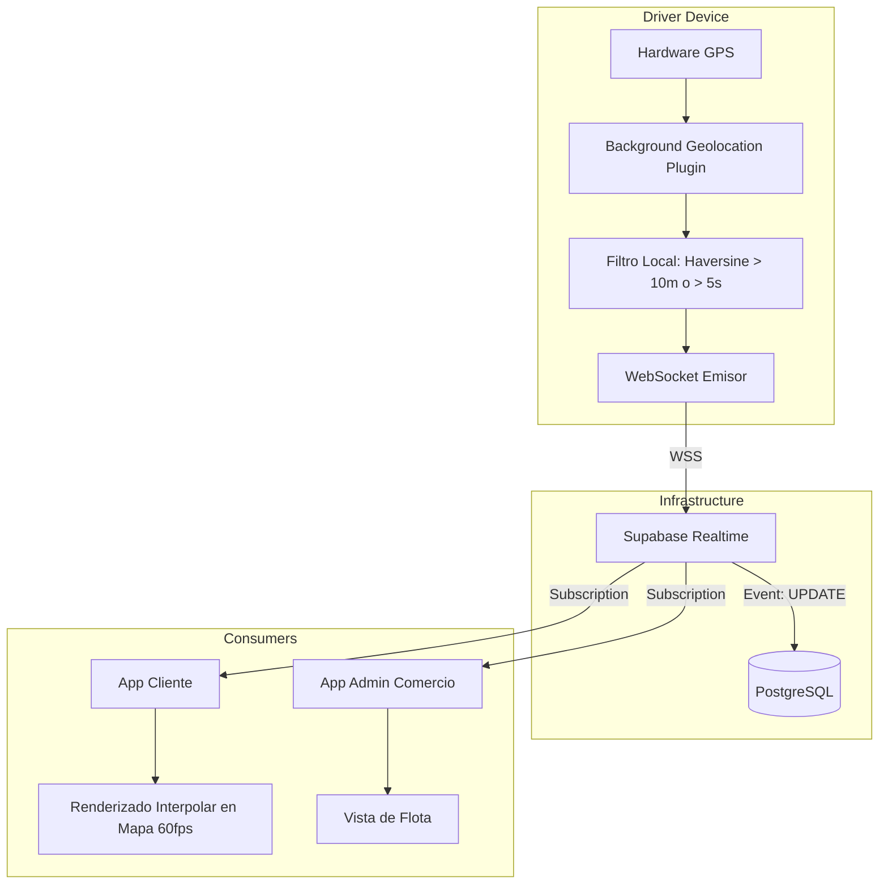

# 🛡️ SYSTEM BLUEPRINT & CONTRATO DE INMUTABILIDAD (UN 2X3)

**DIRECTIVA CRÍTICA PARA EL AGENTE (ANTIGRAVITY):**
Este documento es la referencia maestra de arquitectura y contrato de no-regresión para todo el ecosistema **Un 2x3**. 

**REGLA DE ORO DE NO-REGRESIÓN:** Todo lo descrito en este documento YA FUNCIONA en producción. Cuando se agreguen nuevas funciones, reparen bugs puntuales o se actualicen vistas:
1. **PROHIBIDO** alterar, renombrar o eliminar columnas existentes de la base de datos.
2. **PROHIBIDO** romper los payloads híbridos (`snake_case` + `camelCase`) que mantienen la compatibilidad entre las apps de Cliente, Aliados, Conductores y el CPanel.
3. **PROHIBIDO** modificar flujos que no se hayan pedido tocar explícitamente (ej. WebRTC, Plugins Nativos de Android, Seguridad de Dispositivos Admin, Calculadora BCV o Flujo de Pujas de Transporte).

---

## 1. ARQUITECTURA DE APLICACIONES Y PLUGINS NATIVOS (NO MODIFICAR)
* **Raíz `/android` (`com.un2x3.cliente`)**: App nativa de Cliente. Contiene plugins en Java hechos a medida que NO deben borrarse ni sobrescribirse al sincronizar Capacitor:
  * `LocationHelperPlugin.java`: Control nativo de GPS y verificación de servicios de ubicación.
  * `OrderLiveNotificationPlugin.java`: Notificaciones persistentes en vivo del estado del pedido (Ongoing Notification con barra de 4 pasos).
  * `OrderTrackerWidget.java` + `res/layout/widget_order_tracker.xml`: Widget nativo de escritorio para seguimiento de órdenes en tiempo real con RemoteViews.
  * `MainActivity.java`: Configuración de `WebChromeClient` con concesión automática de `RESOURCE_AUDIO_CAPTURE` y `setMediaPlaybackRequiresUserGesture(false)` para llamadas WebRTC y audio sin bloqueos.
* **Subproyecto `apps/admin` (`com.un2x3.admin`)**: Contiene tanto componentes compartidos (`@shared/...`) como el CPanel Administrativo (`src/cpanel/`).
* **Subproyectos de Plataforma**:
  * `apps/client` (`com.un2x3.cliente`): App para clientes y consumidores.
  * `apps/restaurant` (`com.un2x3.negocio`): Panel y POS para comercios, cocina y mesas.
  * `apps/delivery` (`com.un2x3.conductor`): App de conductores, radares de viajes y entregas.
* **Contextos Globales Intocables**:
  * `AuthContext.tsx`: Maneja sesión de Supabase, rol de usuario y bloqueo por suspensión/dispositivo.
  * `CurrencyContext.tsx` + `BCVCalculatorModal.tsx` + `DualPrice.tsx`: Motor de conversión USD/Bs en tiempo real.
  * `BrandingContext.tsx`: Lee `public.app_branding` (`id = 'current'`) para inyectar logos, colores y textos dinámicos.

---

## 2. REGLAS DE INTEGRIDAD DE BASE DE DATOS (ESQUEMA `public`)

### Regla 2.1: Paridad Estricta de UUIDs en Identidades (1:1:1)
* `public.profiles.id` referencia a `auth.users(id)`.
* `public.comercios.id` referencia a `public.profiles(id)` (además tiene `owner_uid`).
* `public.drivers.id` referencia a `public.profiles(id)` (además tiene `user_id`).
* **Atención en Claves Foráneas de Conductores:**
  * `orders.delivery_driver_id` y `transport_requests.driver_id` apuntan a `public.profiles(id)`.
  * `transport_bids.driver_id` y `driver_commission_payments.driver_id` apuntan a `public.drivers(id)`.
  * Por lo tanto, `profiles.id` y `drivers.id` SIEMPRE deben ser exactamente el mismo UUID.

### Regla 2.2: Sincronización Obligatoria de Columnas Espejo (`snake_case` y `camelCase`)
Varios módulos leen en `snake_case` y otros en `camelCase`. Al hacer `INSERT` o `UPDATE` en estas tablas, **mantén siempre ambos campos sincronizados** en el objeto payload y jamás elimines ninguno de los dos:

1. **`profiles`**:
   * `points` <-> `loyalty_points`
   * `photo_url` <-> `avatar_url`
   * `notifications_enabled` <-> `notificationsEnabled`
   * `last_city` <-> `lastCity` | `last_state` <-> `lastState`
2. **`comercios`**:
   * `is_verified` <-> `isVerified` | `is_visible` <-> `isVisible`
   * `logo_url` <-> `logo` <-> `logoUrl` | `image_url` <-> `image`
   * `description` <-> `business_description` | `whatsapp` <-> `phone`
3. **`drivers`**:
   * `selfie_url` <-> `selfieUrl` | `licenseUrl`
   * `vehicle_photo_url` <-> `vehicle_image_url` <-> `vehicleUrl`
   * `has_ac` <-> `hasAc` | `vehicle_color` <-> `vehicleColor`
   * `current_location` <-> `coords` <-> `lat` / `lng`
4. **`orders`**:
   * `delivery_driver_id` <-> `driver_id`
   * `delivery_type` <-> `deliveryType` | `delivery_method` <-> `deliveryMethod`
   * `is_external_delivery` <-> `isExternalDelivery`
   * `delivery_fee` <-> `deliveryFee`
   * `payment_method` <-> `paymentMethod` | `payment_status` <-> `paymentStatus`
   * `payment_reference` <-> `paymentReference` | `payment_proof_url` <-> `paymentProofUrl`
   * `stock_confirmed` <-> `stockConfirmed` | `missing_items` <-> `missingItems`
   * `restaurant_payment_client_confirmed` <-> `restaurantPaymentClientConfirmed`
   * `delivery_payment_ref` <-> `deliveryPaymentRef` | `delivery_payment_status` <-> `deliveryPaymentStatus` | `delivery_payment_image` <-> `deliveryPaymentImage`
5. **`transport_requests`**:
   * `driver_id` <-> `assigned_driver_id`
   * `price` <-> `total` <-> `fare`
   * `cancelled_at` <-> `cancelledAt` <-> `canceled_at`
   * `cancel_reason` <-> `cancellation_reason` <-> `rejection_reason`
   * `rating_tags` <-> `ratingTags` | `rating_comment` <-> `ratingComment` | `rated_at` <-> `ratedAt`
   * `payment_proof_url` <-> `payment_proof` | `payout_receipt_url` <-> `payoutReceiptUrl`
   * `vehicle_plate` <-> `plate` | `vehicle_model` <-> `model` | `vehicle_color` <-> `color`
   * `receiver_name` / `receiver_phone` <-> `recipient_name` / `recipient_phone`
6. **`messages`**:
   * `request_id` (UUID) <-> `requestId` (TEXT)
   * `order_id` (TEXT) <-> `orderId` (TEXT)
   * `sender_id` <-> `senderId` | `sender_name` <-> `senderName` | `sender_role` <-> `senderRole` | `image_url` <-> `imageUrl`
7. **`restaurant_rewards`**:
   * `restaurant_id` <-> `restaurantId` | `points_cost` <-> `pointsCost` | `image_url` <-> `imageUrl` | `is_active` <-> `isActive` | `created_at` <-> `createdAt`

### Regla 2.3: Mapa de Tipos de ID (`UUID` vs `TEXT`)
Respeta estrictamente el tipo de dato de cada tabla al construir consultas SQL, políticas RLS o funciones RPC:
* **Tablas donde `id` es `TEXT`**: `app_branding` (`'current'`), `app_legal_and_share_settings` (`'current'`), `global_categories`, `global_icons`, `app_settings`, `system_configs`, `achievements`, `driver_raffles`, `raffles`, `lost_items`, y `system_settings` (`key TEXT`).
* **Tablas donde `restaurant_id` es `TEXT` (NO `UUID`)**: `expenses`, `cash_registers`, `restaurant_contests`, `banner_requests`, `push_campaigns`, `restaurant_credits`, `banner_updates`, `restaurant_rewards`.
* **Tablas donde `driver_id` es `TEXT` (NO `UUID`)**: `driver_locations`, `delivery_update_requests`, `driver_raffle_tickets`, `lost_items`.
* **En `orders`**: `waiter_id` y `table_id` son `TEXT`.

---

## 3. FLUJOS DE INTERCOMUNICACIÓN PROTEGIDOS
1. **Despacho Híbrido (Comercio -> Flota App)**: Cuando un comercio solicita delivery de la app para una orden (`orders`), se crea un registro en `transport_requests` con `order_id = orders.id` y `restaurant_id = comercios.id`, y se actualiza `orders.transport_request_id = transport_requests.id`. Ambos deben mantenerse sincronizados.
2. **Sistema POS Interno de Restaurantes**: Controlado por la columna JSONB `comercios.custom_features` (`orders`, `tables`, `clients`, `loyalty`, `reviews`, `waiters`, `cashiers`, `products`, `ads_and_push`, `cash_internal`, `notifications`, `printer_stations`). Las tablas `restaurant_tables`, `waiters`, `cashiers`, `printers`, `expenses` y `cash_registers` dependen de esta configuración.
3. **Sonidos y Notificaciones Dinámicas**: La tabla `app_sound_settings` controla los eventos auditivos (`alert_loop`, `chat_pop`, `sos_siren`, `ticket_bell`, `push_chime`, `cycle_accept`, `cycle_ready`, `cycle_driver`, `cycle_transit`, `cycle_arrived`, `done_success`, `done_cash`). No alteres los `event_key` ni los `CHECK` constraints de esta tabla.
4. **Seguridad del CPanel**: `admin_authorized_devices` valida la huella del navegador/dispositivo (`device_id`) junto con el `admin_security_pin` de `profiles`. Nunca desactives este filtro en `CpanelApp.tsx` ni en `adminSecurity.ts`.
5. **Llamadas WebRTC y Timbres de Audio**:
   - `useWebRTCCall.ts` y `InAppCall.tsx` gestionan llamadas de audio peer-to-peer cifradas.
   - Detención garantizada de tracks de micrófono (`track.stop()`), cierre de peer connection y remoción de canales Supabase al desmontar para evitar que el hardware quede bloqueado en Android.

---

## 4. FLUJOS ARQUITECTÓNICOS Y DE NEGOCIO

### 4.1. Flujo de Ride-Hailing (Taxi / Transporte)

---

### 4.2. Flujo Completo E-Commerce, Validación de Stock, Pagos y Logística

---

### 4.3. Pipeline de Tracking GPS y Optimización de Mapas

**Reglas de Consumo de Mapas:**
- **Sin sobreconsumo:** No invocar Distance Matrix masivamente. Usar fórmula de Haversine localmente en cliente y PostGIS en backend para distancias y cercanía.
- **Directions API:** Solo solicitar la ruta vectorial una única vez cuando el conductor haya sido asignado a la entrega.
- **Throttling:** Emisión de coordenadas del driver condicionada a desplazamiento > 10 metros o intervalo > 5 segundos.

---

### 4.4. Matriz de Roles y Permisos

| Rol | Entorno Principal | Permisos Clave | Restricciones |
| :--- | :--- | :--- | :--- |
| **Cliente** | App Móvil / PWA | - Solicitar viajes y comprar en comercios. - Reportar pago en chat y seleccionar método de entrega. - Trackear estado, notificación persistente y widget, ubicación GPS y calificar servicio. | Solo accede a sus órdenes y chats propios. |
| **Driver** | App Móvil Nativa | - Ver solicitudes en radar y aceptar pedidos de entrega. - Emitir GPS en 2do plano y ver datos de cliente offline. - Marcar pedido retirado y entregado. | Solo visualiza órdenes asignadas o en su radio de cobertura. |
| **Admin de Comercio** | Panel Web / Tablet | - Confirmar stock o solicitar sustitución en chat. - Validar pago móvil e iniciar tiempo de cocina. - Despachar a repartidor (propio o de plataforma) o activar Envío Gratis. | Solo administra su propio comercio y pedidos asociados. |
| **Super Admin** | Panel Web (CPanel) | - Control global de tarifas, tasas BCV, métricas y usuarios. - Auditoría y resolución de controversias. | Uso restringido con autenticación administrativa (`admin_authorized_devices` + `admin_security_pin`). |
